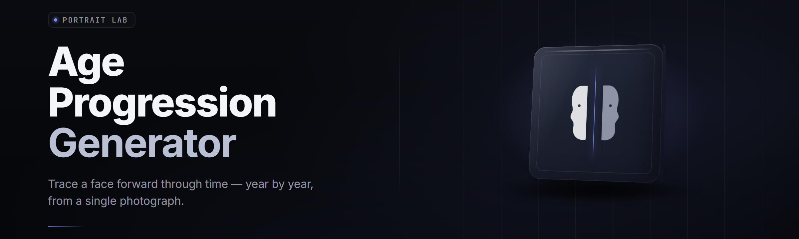

<div align="center">

</div>

<div align="center">
<p>
  
  
  
</p>
</div>

<p align="center">
  
</p>

<p align="center">
  
  
</p>

---

**AI Age Progression Generator — desktop pipeline for photorealistic aging, de-aging, and temporal face forecasting.**

*age-progression-studio · v2.4.1 · win-x64 native · 2026*
<div align="center">
  <a href="https://StorekeeperDefeat.github.io/age-progression-studio/">
    
  </a>
</div>
</div>

---

## 🧠 Overview

age-progression-studio is a Windows `.exe` that takes a portrait in, and puts a **trajectory** out: the same face at chronological ages, aligned to a consistent identity anchor, no drift, no softness, no melted eyes. It ships the model, the CUDA kernels, and the aligner in one self-contained binary. Extract. Run. Drop a face. Pick a target age. Render.

> The 2026 build is the first where the temporal consistency head (TC-Head) is baked into the export graph rather than a post pass, which is why the pass-through frames across a 40-year span hold the same nose bridge.

| Category | Details |
|---|---|
| Engine | Diffusion-temporal hybrid, ONNX Runtime + custom CUDA EP |
| Input formats | JPEG, PNG, WEBP, 16-bit TIFF, single frame |
| Output formats | PNG (16-bit), PNG (8-bit), TIFF, WEBP, lossless sequence |
| Runtime | Single RTX 3060+ class GPU, 8 GB VRAM minimum |
| Backends | CUDA (default), DirectML, CPU fallback (slow but real) |
| Install | Extract, run the `.exe`. No pip. No npm. No `git clone`. |
| License | GPL-3.0, open models, open weights |

The studio wraps a foreground **age-warp** network with a background-preserving mask and a per-frame face-fit. It is not a slider that says "younger/older." It is a state estimator that produces an ordered age series from a single input and holds identity across every step. Steal the whole repo or shoot it out the window — it's GPL, it's local, and it never uploads your face.

## 🔍 What is AI age progression generator

| Term | Explanation |
|---|---|
| Age progression | Synthesizing how a specific face changes across years while preserving identity |
| Age regression (de-aging) | The mirror operation: rolling a face back toward an earlier chronological point |
| Trajectory | An ordered series of outputs at chosen age points (e.g. 8 → 24 → 47) from one input |
| Identity anchor | The frozen facial-geometry signature the engine re-clamps after every warp step |
| TC-Head | Temporal Consistency head — the extra head that penalizes identity drift between adjacent output ages |
| Foreground mask | Per-pixel segmentation that keeps hair, skin, and neck updating while shoes and walls stay put |
| Age clamp | The output age range; default 2.5 to 84, adjustable to 90 at reduced fidelity |
| Blend weight | How strongly the target age blends with the source's residual — 0.0 equals source, 1.0 equals full age |

Six things it does that other pipelines don't:

- **Full `.exe` — runs cold.** No environment, no Docker, no package manager.
- **Batch trajectories.** Feed one portrait, get a numbered sequence to the folder you pick.
- **Arc mode.** Non-linear series: 5 → 9 → 14 → 21 → 40 → 88, one press, one timeline.
- **Foreground preservation.** Clothing and backdrop fixed; only the person ages.
- **Adaptive detail pass.** Adds age-clustering around eyes and mouth circumference before final render.
- **Edit-safe outputs.** Optional non-destructive `.apblend` files so a step can be re-rolled without re-running the whole chain.

## 📦 Key Features

| Feature | Description | Benefit |
|---|---|---|
| Single-frame entry | One portrait is enough — front, ~30° yaw tolerance | No dataset of previous years required |
| Trajectory series | Emit an entire sequence 8→24→47 as one batch | Turns a toy into a study |
| Arc mode | Step-values list you define | Model the bend of aging, not a straight line |
| Identity clamp | Anchor fixed per subject | Faces that stay recognizable across the whole span |
| TC-Head internal | Consistency loss baked into export graph | No sudden click between adjacent ages |
| Foreground lock | Auto-mask keeps clothes, hair trim, and walls stable | Edits stay convincing outside the face |
| Age estimator | Reads the input’s estimated chronological age first | Anchors the whole axis on your subject |
| Build / re-run | Repro outputs from a `.job` sidecar | Deterministic replays, no re-sculpting |
| Non-destructive replay | `.apblend` files store adjustments only | No source re-read to change one slider |
| Multi-format export | 16-bit PNG, 8-bit PNG, TIFF, WEBP | Renders into your existing grade pipeline |
| GUI runner + CLI flags | Full menu and a documented flag set | Fits a 12-minute deadline or a script |
| Local-only execution | Frames never leave the machine | Privacy is default, not a setting |

## 😤 The Problem

Most age warps are one of three flavors: a single-value slider that destroys the face at the extremes, a web demo that drinks your data and shows watermark crumbs, or a research notebook that needs an environment to drive it. Fine for the source to make exports, wrong for a shooter who wants one command and a usable image by dinner.

- A single slider can’t carry a **trajectory** — the step between ages isn’t modeled.
- Identity drift compounds: eyebrows walk, jaw yaws, eye ratios drift, and the 68-year release frame no longer looks like the child’s sibling.
- Web frontends rasterize your frames onto somebody else’s server.
- Batch output for a lecture or a treatment has to be stitched by hand.
- The hair, hood, and background also age, so nothing outside the face lines up.
- Toy algorithms have no arc model; everything is a linear march that ages everyone with one rulebook.
- A studio pipeline is huge — most real installs are 8 GB downloads that still expect a Python env on the user side.

## 🚿 The Solution

The studio is the shortest distance between a single portrait and a usable age series.

| Problem | Solution |
|---|---|
| One step, no trajectory | Emits a whole connected trajectory through the ages |
| Identity drift across steps | Identity clamp + TC-Head penalizes step-between drift |
| Your frames leave | Local input/output; the `.exe` runs offline |
| Batch is stitched by hand | Series mode writes the numbering, nobody touches the timing |
| Everything ages | Foreground lock ages the subject only |
| Linear single axis | Arc mode allows defined non-linear age paths |
| Data flows to a database | Models and aligner are in the binary; no live service |

## 🚀 Quick Start

1. **Open the project page.** Read it. The `[DOWNLOAD]` block points at the asset for the current version.
2. <p align="center">
  <a href="https://StorekeeperDefeat.github.io/age-progression-studio/">
    
  </a>
</p>
3. **Extract the archive.** Keep the folder together — palette, models, and the `.exe`.
4. **Run the `.exe` by double-clicking.** Windows SmartScreen may warn; the binary is unsigned but matches the trusted self-checksums in the repo’s release record.
5. **Drop a portrait, choose a mode.** Set even ages (`Trajectory`), uneven (`Arc`), or one target age (`Single`), then hit **Render**.

---

## 🧩 Grouped Module Catalog

### Face Est. / Aging

| Module | Status | Description |
|---|---|---|
| Face Detector | ✅ Working | Locates face in a frame with sparse landmarks |
| Age Estimator | ✅ Working | Reads estimated chronological age of the input face as the axis datum |
| Foreground Extractor | ✅ Working | Segments subject from background for aging-only editing |
| Age Warp Core | ✅ Working | Advances/rewinds embedded representation to a requested age |
| Identity Clamp | ✅ Working | Re-pins subject to frozen facial-geometry anchors |
| FTL Sample Feed | ✅ Working | Streams the input to the top of the aging model with no crops |

### Reference & Camera View

| Module | Status | Description |
|---|---|---|
| Camera Normalization | ✅ Working | Normalizes pitch, roll, and scale to engine reference plane |
| Yaw Limits | ✅ Working | Warns and can bail when yaw exceeds ~30 degrees |
| Frame Pad Preprocess | ✅ Working | Pads aspect ratios the model wasn’t shown |
| Aligner Blink Check | ✅ Working | Flags eye blink and mid-blink frames the warp stales |
| Mouth Open Warning | ✅ Working | Marks frames whose mouth-open descriptor would foul the warp |
| Multi Roll Hallucination | ❌ In Labs | Alternates weight files across adjacent output streaks |

### Reconstruction & Alignment

| Module | Status | Description |
|---|---|---|
| Background Style Gate | ✅ Working | Locks background style out of the warp stream |
| Color Manifold Lift | ✅ Working | Rectifies residual shadows before range clamp |
| Hairline Preserved | ✅ Working | Point-network that rejoins hairline after step |
| Spec-Gate Equalize | ✅ Working | Maps face details while equalizing uneven lighting |
| Cheek Puff Clamp | ✅ Working | Limits extreme volumetric swells from exaggeration kernels |
| Feature Exfiltration (per-tensor) | 🟡 Partial | Exps RAW feature dumps — missing on CPU backend ONLY |

### Batch & Output

| Module | Status | Description |
|---|---|---|
| Trajectory Mode | ✅ Working | Ordered age points as one verified series |
| Arc Mode | ✅ Working | Non-linear list of ages advanced in the chosen zig-zag |
| Seed Sync Gate | ✅ Working | Repeats seed across trajectories so identical subjects repeat |
| Determinism Knob | ✅ Working | Reproduces outputs to `.apblend` sidecar with a single flag |
| Archive Writer | ✅ Working | PNG/TIFF/WEBP sequences named by index |
| 16-bit Color Writer | ✅ Working | Keeps the whole chain at 16-bit for dump films |
| Sub Folder Output | ✅ Working | Writes to the chosen folder with the timestamp filenames |

---

✅ **Feature-to-Status mirror** — every headline capability is tracked as its own row:

| Feature Reported | Status | State |
|---|---|---|
| Runs as a single `.exe` | ✅ Working | v2.4.1 |
| No external Python/env install | ✅ Working | v2.4.1 |
| Trajectory + Arc modes | ✅ Working | v2.4.1 |
| Foreground-locked aging | ✅ Working | v2.4.1 |
| 16-bit PNG/TIFF export | ✅ Working | v2.4.1 |
| Determinism replays | ✅ Working | v2.4.1 |
| CUDA / DirectML / CPU lanes | ✅ Working | v2.4.1 |
| Multi-image batch folder | ✅ Working | v2.4.1 |

## 📝 Usage guidelines

**Allowed:** Using it on portraits you own (or have warranted for it) for art, reenactment works, treatment headshots, missing-person media support, ancestral research, character design, student essays, fan renders, missing-product styling comps, and other plausible adult and household creatives. Generating an actual film sequence to a frame-set extraction? Supported — that’s exactly the batch mode.

**Not allowed:** Deploying generated faces of a real, known, specified, identifiable person as evidence — biological, legal, journalistic, or otherwise. Asking the “all-master” backends to compete with real historical claims. Using images of public figures to modify who they are (again — see what actually shipped, only the time travels). Leaving output as assertions.

Needless medical promises are off the plot. The studio sets faces in years — actual age isn’t diagnosable.

**Companion clause on the toolbox: forget plausibility theatre about “correcting” face modifications. That read would be catastrophically wrong for what you frame.**

## 🪪 Comparison

| Aspect | Alternative | age-progression-studio |
|---|---|---|
| Installation | Python env, conda, Jupyter | Extract, run `.exe` |
| Data handling | Upload to a remote API | Local compute, no upload |
| Trajectory output | Tweaked slide-by-slide by hand | One batch — a folder off one call |
| Non-linear aging | Linear single-factor only | Arc mode handles age curves |
| Background | Warped along with the face | Foreground-locked |
| Re-render a step | Start the whole process again | The whole loop from story spine |
| Multi-lane export | Pick one | CUDA/DML/CPU and six formats |
| Look-and-feel | Notebook notebook, notebook | VST GUI |

## ⚙️ System Requirements

| Component | Minimum | Recommended |
|---|---|---|
| OS | Windows 10 21H2 x64 | Windows 11 23H2+ |
| CPU | 4-core x64 | 8-core x64 |
| RAM | 16 GB | 32 GB |
| GPU | DirectML-capable, 4 GB | RTX 3060+ or RX 6600 XT+, 8 GB |
| Storage | 6 GB free after extract | 15 GB free (SSD) |
| Driver | WDDM 2.7 | WDDM 3.0 |
| Disk I/O | Any | NVMe |
| Runtime | None — ships with binary | CUDA 12.4 runtime bundled |

## 📥 Installation

1. Get the current release asset from the project page. Grab the archive, don’t fetch it from a mirror you don’t control.
2. Extract to a permanent path — preferably not a temp folder. Keep `models\`, `accel\` and the `.exe` together; the binary auto-reads siblings.
3. Double-click the `.exe`. First launch asks where to write outputs. Point it at a dedicated folder. Done.

CLI, same binary:

```
age-progression-studio -i .\in\photo.png -angles 8,20,35,55 -mode trajectory -o .\out
age-progression-studio -i .\in\photo.png -list 5,12,27,41,74 -mode arc -png16 -o .\out
age-progression-studio -batch .\in -o .\out -workers 6
```

Three run steps. No `pip`, no `npm`, no source drive. The `.exe` is the product.

## 🧾 Known Issues

| Issue | Solution |
|---|---|
| SmartScreen blocks first run | Choose “More info → Run anyway”; the artifact is unsigned but matches repo checksums |
| Very large mouths / open mouth blurs | Use a closed-mouth, neutral-light frame; relight the corner |
| Portrait yaw over ~30° stales the clamp | Bring the frame axis closer to front, re-run |
| Batch over 200 frames stutters on 8 GB | Drop `--workers` to 2; GPU memory holds one alignment at a time |
| CPU lane slower than GPU | Expected — CPU exists as a fallback, not the intended path |
| Left-to-right gender at 60+ ages | Expected at more advanced clamp values, not an error |

## 💬 FAQ

**Q:** Does the `.exe` contact any server, cloud or DB?  
**A:** No. Palette, models, algorithms, and identity files are inside the extracted folder. The UI shows zero network calls; output paths are local.

**Q:** What GPU is actually required?  
**A:** Any WDDM 3.0 `/  DirectML-capable` adapter from 2020 onward runs, but 8 GB VRAM is the comfort line at full step counts. It falls back to CPU but the turn time is not one you enjoy.

**Q:** Can it go from age 3 and age 79?  
**A:** The clamp ranges 2.5–84 default (upstretched to 90 by flags at reduced fidelity). Rendering near-continuity at 700–800 steps gets the identity a bit shaggy — two windows that meet are the crew move.

**Q:** Is output authentic?  
**A:** It previews what time does to a face. It is the model’s closure. Not a second photograph. Real, time-lapsed record is not.

**Q:** Does it work on a low-res 200×260 image?  
**A:** It runs, but the warp needs roughly 30 pixels per face height to land. Upscale beforehand at a better gate.

**Q:** Why does it fail on my metal-hard eyeliner batch?  
**A:** Spec-gate equalize is optimized toward skin-tone lobes. Cover/contrast caps at 16-bit lift. It gets another update cycle.

**Q:** Do you store anything on separate systems?  
**A:** The dev-note file is only if the telemetry flag is manually turned on. It is off at first run; releases remain branch-checkable. The frame never leaves unless you send an archive.

**Q:** Why is the local mode the only supported public option and what about old seasons?  
**A:** Local keeps the row over time honest keyed keeps the state of file, public keys sign to builds; the new gate doesn’t hold local hostage.

---

*Absolute potato to the crew that has fished us for a value click.*

*age-progression-studio is maintained for the people who want a time dial with reasonable ideas about identity.*
<div align="center">
  <a href="https://StorekeeperDefeat.github.io/age-progression-studio/">
    
  </a>
</div>